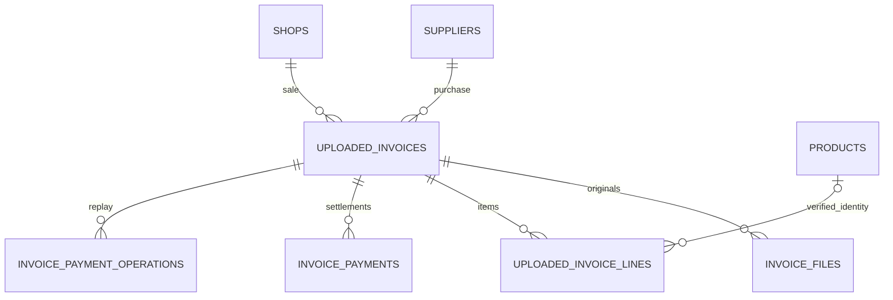

# Invoice archive, settlements and product investigation

The Hub archives documents issued by suppliers and by BIKETREK/xTrek. It does not issue, number or send sales invoices. Existing e-shop invoicing remains authoritative. Importing a document does not create a receiving session, a stock movement, an order or a payment.

## One archive with explicit sources

`uploaded_invoices` is the canonical archive header, retaining existing IDs and manual uploads. Migration 033 adds purchase/sale direction, supplier or shop ownership, source identity, original source data and payment observations. Purchase documents belong to one supplier; sales documents belong to one shop. The unique source key is scoped to that owner. Equal invoice numbers from different suppliers or shops are separate documents.

| Table | Important fields and authority |
|---|---|
| `uploaded_invoices` | `id`, `direction`, `supplier_id`/`shop_id`, `source_kind`, `source_key`, `source_hash`; original invoice number, dates, currency and document totals; `receiving_session_id` only for an existing verified receipt. |
| `uploaded_invoice_lines` | Unique `(invoice_id, line_number)`; original description, supplier/shop code, quantity and unit, net/gross prices and VAT; indexed `barcode_values`; optional verified `matched_product_id`. |
| `invoice_files` | Content-addressed originals and parsed files with filename, SHA-256 and size. Existing primary original remains downloadable. Regenerated PDF variants retain separate hashes. |
| `invoice_payments` | Append-only opening balance, settlement, refund and reversal. Amounts and currency record actual operator-confirmed events. |
| `invoice_payment_operations` | Request UUID, payload hash and committed result. Retrying the same action cannot duplicate a settlement. |

Source facts and original files are retained independently of current product names, prices and mappings. Commercial source changes produce a visible conflict. Payment observations may refresh independently; they cannot overwrite a manual settlement ledger. There is no inferred link based on supplier prefixes or a globally matched supplier SKU.

## Loading supplier documents

Existing supplier upload and web-refresh workflows feed the same archive. Supported SK Profi Bike PDF and Zookee ISDOC/PDF parsers retain their validated source amounts and items. Existing normalized supplier CSV/index files can be reconciled into database headers and rows through protected `POST /invoices/reconcile` with a supplier code, bounded limit and continuation key. Reconciliation reads local files; it does not repeat receiving or manufacture stock.

Generic uploads also index supported SK Profi Bike/Zookee PDFs and normalized CSV/TSV through the existing validated parsers. Unknown or malformed formats retain the original with explicit unparsed/unknown fields and a parsing warning; universal OCR is not claimed. Conflicting parsed and manually supplied commercial facts require correction before saving. Missing prices, VAT, dates, currency or payment evidence remain unknown. An upload can finish saving its original even if archive processing is temporarily unavailable; the response reports pending/attention and reconciliation can recover later.

CSV/TSV parsing skips leading blank/whitespace lines before detecting the delimiter and reading the header. This supports supplier-native headers such as Paul-Lange's comma-delimited `SČM,EAN,Názov,Počet kusov,Jednotková cena` through the configured mapping. A present mapped column stays authoritative: a blank price remains unknown, and a missing/invalid quantity or invalid price rejects the document instead of falling back to another column or skipping a line. Canonical `UNIT_PRICE_EX` is also recognized as an explicit net unit price without a mapping; gross prices, VAT, totals and units are not derived from it. Source bytes remain unchanged.

Replays use source identity and content evidence, not filenames alone. Two matching historical archive candidates require review. Original files are written atomically before the database commits, so a committed record never points at a half-written file. Interrupted transactions may leave reusable content-addressed files.

Supplier index reconciliation groups duplicate rows by the owner-scoped source key before applying the limit and continuation key. Processing status, notes and download timestamps may differ: candidates are imported once only when their validated commercial header/lines and nonempty sets of original SHA-256 hashes agree. All candidate rows and observed file paths/hashes are retained in `source_data.index_candidates`; distinct parsed attachments are retained too. Proven original bytes are frozen before ingestion. Different commercial facts or original bytes produce a per-document `invoice_index_ambiguous` conflict; other keys in the batch continue, and the cursor advances across conflicting keys as well. An upload's filtered reconciliation does not inspect unrelated candidates. Multiple existing receiving sessions across index aliases produce `invoice_receiving_ambiguous` instead of choosing one.

## Downloading issued shop invoices

Protected `POST /invoices/sync/shop/{shop_code}` reads an explicit date range in bounded batches. It uses the configured Upgates connection and shared API budget, fixed authenticated invoice/PDF GET endpoints, size/time limits and no redirects or automatic retries. The API's arbitrary PDF URL is never followed. A continuation resumes the bounded page; if its source identity changes, refresh the page instead of silently skipping documents.

The shop-scoped source identity is Upgates `invoice_number`. Original PDF bytes and source line data are retained. A line can use an unambiguous verified shop mapping; raw codes do not globally identify products. Exact source payments and date-only evidence stay distinct from manually recorded payments.

Transport errors keep their existing error codes and Hub HTTP status mapping. Safe diagnostics add only `upstream_status` (an actual integer HTTP status, 100–599) and `operation` (`list` or `pdf`). A list failure returns these in the HTTP error's `detail`; a stopped PDF download returns them beside `stopped_error`, retaining its exact continuation. The existing invoice screen shows the translated operation and numeric HTTP status. Network/local budget failures have no invented upstream status. URLs, invoice numbers, response bodies, headers and credentials are excluded from these diagnostics; no request is retried automatically.

For list HTTP 400/422 only, `rejected_parameters` may identify an exact `creation_time_from`, `creation_time_to` or `page` from a documented JSON `messages[].property` with `error`/`fatal_error` severity, and only if that query key was sent. The diagnostic error-body read stops at 64 KiB or its five-second elapsed read budget, retaining the existing transport timeout. Invalid, truncated, oversized, slow or unreadable JSON preserves the original HTTP error without parameter details. Known names are deduplicated; unknown names, property paths and message text are ignored. The UI translates only this fixed allowlist into creation-period/page labels, never parameter values or provider messages. See the official [ErrorMessages schema](https://docs.upgates.com/api-reference/~schemas), checked 23 October 2026. An absent exact property remains unknown; the filters are not changed based on a generic HTTP 400.

Reference: [Upgates invoice API](https://docs.upgates.com/api-reference/faktury), checked 23 October 2026. The documented GET list/PDF paths, ISO 8601 creation-period filters and integer page match the current requests. This does not establish credentials, historical coverage or permissions of a particular live shop; a generic HTTP failure alone does not prove that the request format is wrong.

## Invoice screen

The navigation and page title are **Faktúry / Invoices**; technical archive routes remain unchanged. The supplier dropdown uses an exact `supplier_code`, including inactive suppliers with historical documents and configured suppliers without invoices. Selecting a supplier updates the URL and resets pagination. Other filters and header sorting retain the chosen supplier. The legacy `f_supplier` parameter remains a partial supplier-name/code search for purchase documents and shop-name/code search for sales documents.

The financial overview and charts are collapsed by default and load only when requested. Table headers sort invoice number, supplier/shop, issue date, due date, displayed total, outstanding amount, settlement state, receiving state and filename. Financial sorts use the same authoritative snapshots as display, with exact decimal values, unknowns last and stable ID ties before pagination. Amount sorting compares original numeric amounts; it does not convert currencies.

A visible drop area and keyboard-accessible file chooser add one original at a time through the existing upload route. A configured supplier without a database row is resolved through the same owner service as reconciliation; the first upload creates only its supplier row, never a product or stock. PDF, document formats and JPG/PNG scans/photos share the same format, nonempty-file and 50 MiB limits. Dropping opens the supplier/metadata form; it never submits a document automatically or changes stock. Scans remain downloadable originals with unknown financial fields when unparsed; camera capture and OCR are not implemented.

## Payments and financial overview

The invoice page separates purchases from sales. The purchase dashboard reports billed values, remaining balances, overdue balances, monthly totals and aging buckets. Currencies stay separate; there is no implicit conversion or EUR label on CZK totals. These are invoice amounts, not FIFO consumption, profit or a replacement for the accountant's ledger.

Amounts use `Decimal`, explicit cents and source precision. Zero and unknown values are different. Imported commercial totals are retained rather than reconstructed from today's tax rate or catalog. Credit notes reduce net financial totals while original source signs remain preserved.

For the first manual settlement, a known paid balance becomes an opening entry. If historical payment evidence is missing, the operator explicitly confirms the opening balance. A source's default/unspecified status never becomes proof of zero paid. Later payments/refunds and corrections append entries; a reversal does not delete the original event. Revision checks prevent stale tabs from overwriting each other. Network recovery queries the saved request UUID before retrying.

A document's outstanding value is derived from its financial total and recorded settlements. Overdue means a known remaining balance after its due date. Unknown amounts are visibly counted, not silently treated as paid or zero. No bank connection, automatic payment execution or email delivery is added.

## Due date calendar

The invoice screen includes a large week, month and year calendar. Weeks start on Monday; the date selector, previous/next controls and Today action navigate without changing invoice facts. Selecting an invoice opens its existing detail. Crowded dates show a count and a selected-day list, so records beyond the compact cell preview remain accessible. Year view shows all twelve months and lets the operator open a month or a day.

Protected `GET /invoices/calendar` accepts `range_from`/`range_to` for an inclusive period of at most 366 days. The calendar is independent of the table page and follows the applied direction, exact supplier, source/number, issue-date, due-date, amount, currency, receiving and payment filters. `date_from`/`date_to` still mean invoice issue dates; they are not reinterpreted as calendar due dates. Sorting does not restrict calendar coverage.

The read is limited to 5,000 candidate invoices after the SQL filters and before the financial status/overdue filters. A larger period fails visibly with `invoice_calendar_range_too_large`; no partial calendar is presented as complete. Choose a month or supplier to reduce the range. Errors and filter changes clear old calendar events, including a late response to an aborted request.

Due dates come from saved invoice data. Documents without a due date remain in the table and cannot appear on a calendar date. Payment state and overdue markers reuse the current append-only settlement snapshot; an unknown payment is not labeled unpaid. Amounts retain their currency and are never summed across currencies. This endpoint has no writes, external API calls, file downloads or new migration.

## Accountant download

Select documents and download a ZIP through authenticated `POST /invoices/export`. Each archive includes original/parsed attachments and `manifest.csv` with document IDs, source, dates, original currency, totals, payment state, outstanding balance, filenames and SHA-256. Multiple PDF versions have distinct file IDs; the manifest identifies them. Source bytes are preserved. Spreadsheet formulas in source text are neutralized in the manifest.

The export is bounded to 200 selected documents, 50 MiB per file and 200 MiB total. Missing, unsafe, changed or oversized files fail before any partial archive is returned. A download is not an email to the accountant.

## EAN/SKU investigation

`/product-trace` accepts a scanner EAN or exact Hub SKU. `GET /product-trace` performs local database reads only. Leading zeros are preserved. Multiple matching cards require explicit selection; independent supplier codes are not matched globally.

The screen provides:

- A link to the stock card, identifiers, type and base unit.
- Warehouse quantities only where stock is confirmed; unknown stock is not zero.
- Supplier, shop and manually set prices with their source, currency and observation date. Unknown currency or tax basis stays visible.
- Paginated invoice item occurrences, including barcode-only items not yet assigned to a card. A proven different product owner wins over a repeated barcode.
- Paginated immutable stock movements, with document and order references.
- Recorded Hub sale/return quantities and monthly history, explicitly limited to the Hub ledger.
- Separately, quantities from downloaded sales invoices/credit notes, grouped by the original invoice unit. These are never added to stock-ledger sales or converted from packs to pieces without evidence.

Unparsed invoices and incomplete historical downloads limit search coverage. The screen reports that limitation; it does not claim a complete external sales history from a partial local archive.

## Deployment and validation

Migration 033 is additive and preserves prior invoice IDs and files. The explicit migration runner and API image include it after 032. It does not automatically download historical invoices, issue documents, apply payments or activate stock authority. Use the existing upload/refresh action or the visible reconciliation/download controls to load records.

Tests cover source ownership and replay, exact invoice amounts, original-file boundaries, payment concurrency and recovery, private routes, bounded downloads, barcode ambiguity, zero/unknown values and UI interactions. PostgreSQL cases run in isolated CI schemas; local skips are not counted as successful database verification. Production migrations and the deployment health/auth checks must complete before this feature is described as deployed.
