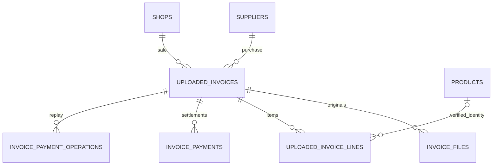

# Invoice archive, settlements and product investigation

The Hub archives documents issued by suppliers and by BIKETREK/xTrek. It does not issue, number or send sales invoices. Existing e-shop invoicing remains authoritative. Importing a document does not create a receiving session, a stock movement, an order or a payment.

## One archive with explicit sources

`uploaded_invoices` is the canonical archive header, retaining existing IDs and manual uploads. Migration 033 adds purchase/sale direction, supplier or shop ownership, source identity, original source data and payment observations. Purchase documents belong to one supplier; sales documents belong to one shop. The unique source key is scoped to that owner. Equal invoice numbers from different suppliers or shops are separate documents.

| Table | Important fields and authority |
|---|---|
| `uploaded_invoices` | `id`, `direction`, `supplier_id`/`shop_id`, `source_kind`, `source_key`, `source_hash`; original invoice number, dates, currency and document totals; `receiving_session_id` only for an existing verified receipt. |
| `uploaded_invoice_lines` | Unique `(invoice_id, line_number)`; original description, supplier/shop code, quantity and unit, net/gross prices and VAT; indexed `barcode_values`; optional verified `matched_product_id`. |
| `invoice_files` | Content-addressed originals and parsed files with filename, SHA-256 and size. Existing primary original remains downloadable. Regenerated PDF variants retain separate hashes. |
| `invoice_payments` | Append-only opening balance, settlement, refund and reversal. Amounts and currency record actual operator-confirmed events. |
| `invoice_payment_operations` | Request UUID, payload hash and committed result. Retrying the same action cannot duplicate a settlement. |

Source facts and original files are retained independently of current product names, prices and mappings. Commercial source changes produce a visible conflict. Payment observations may refresh independently; they cannot overwrite a manual settlement ledger. There is no inferred link based on supplier prefixes or a globally matched supplier SKU.

## Loading supplier documents

Existing supplier upload and web-refresh workflows feed the same archive. Supported SK Profi Bike PDF and Zookee ISDOC/PDF parsers retain their validated source amounts and items. Normalized supplier CSV/index files are copied into database headers and rows automatically. There is no operator approval or extra “Zaradiť” step. The protected `POST /invoices/reconcile` endpoint remains for technical recovery with a supplier code, bounded limit and continuation key. It reads local files; it does not repeat receiving or manufacture stock.

Generic uploads also index supported SK Profi Bike/Zookee PDFs and normalized CSV/TSV through the existing validated parsers. Unknown or malformed formats retain the original with explicit unparsed/unknown fields and a parsing warning; universal OCR is not claimed. Conflicting parsed and manually supplied commercial facts require correction before saving. Missing prices, VAT, dates, currency or payment evidence remain unknown. An upload can finish saving its original even if archive processing is temporarily unavailable; the response reports pending/attention and a background worker recovers automatically. File-first uploads persist a local retry record before the database attempt and remove it only after a successful commit.

The archive worker starts with the PostgreSQL API, elects one worker using a PostgreSQL advisory lock, and scans local supplier indexes every five seconds. It commits batches of 100 source keys and persists the continuation only after commit, so a crash can safely replay the batch. Index modification time/size changes restart the pass; unchanged completed indexes are skipped. Upload retries and transient failures wait 60 seconds; completed passes with source conflicts retry after five minutes. Each supplier progresses independently. This also backfills existing local indexes after deployment, including those larger than the initial 200-document refresh batch. It never downloads new supplier documents or performs receiving.

Recovery records live under `suppliers/<code>/invoices/archive-state/`; they contain local source references and cursors and must remain with the original supplier files. Protected, uncached `GET /invoices/archive-status` exposes pending work and document conflict codes without private filesystem paths. The invoice page polls this status and refreshes its list after progress; conflicting source evidence is retained for correction, never silently overwritten. Filesystem and database backups should be restored together.

CSV/TSV parsing skips leading blank/whitespace lines before detecting the delimiter and reading the header. This supports supplier-native headers such as Paul-Lange's comma-delimited `SČM,EAN,Názov,Počet kusov,Jednotková cena` through the configured mapping. A present mapped column stays authoritative: a blank price remains unknown, and a missing/invalid quantity or invalid price rejects the document instead of falling back to another column or skipping a line. Canonical `UNIT_PRICE_EX` is also recognized as an explicit net unit price without a mapping; gross prices, VAT, totals and units are not derived from it. Source bytes remain unchanged.

Replays use source identity and content evidence, not filenames alone. Two matching historical archive candidates require review. Original files are written atomically before the database commits, so a committed record never points at a half-written file. Interrupted transactions may leave reusable content-addressed files.

Supplier index reconciliation groups duplicate rows by the owner-scoped source key before applying the limit and continuation key. Processing status, notes and download timestamps may differ: candidates are imported once only when their validated commercial header/lines and nonempty sets of original SHA-256 hashes agree. All candidate rows and observed file paths/hashes are retained in `source_data.index_candidates`; distinct parsed attachments are retained too. Proven original bytes are frozen before ingestion. Different commercial facts or original bytes produce a per-document `invoice_index_ambiguous` conflict; other keys in the batch continue, and the cursor advances across conflicting keys as well. An upload's filtered reconciliation does not inspect unrelated candidates. Multiple existing receiving sessions across index aliases produce `invoice_receiving_ambiguous` instead of choosing one.

## Downloading issued shop invoices

Protected `POST /invoices/sync/shop/{shop_code}` reads an explicit date range in bounded batches. It uses the configured Upgates connection and shared API budget, fixed authenticated invoice/PDF GET endpoints, size/time limits and no redirects or automatic retries. The API's arbitrary PDF URL is never followed. A continuation resumes the bounded page; if its source identity changes, refresh the page instead of silently skipping documents.

On 23 October 2026, live BIKETREK diagnostics identified HTTP 400 rejection of `creation_time_to`, then sent as `23:59:59.999999` with the Bratislava offset; a fully historical end date produced the same parameter rejection. The Hub now serializes that cutoff at whole-second precision, `23:59:59`, retaining the selected end date and its Europe/Bratislava UTC offset. The start remains `00:00:00` on the selected first day with its own offset, including across daylight-saving transitions. Both bounds, pagination and page identity remain in place; no unfiltered fallback or retry is added. Acceptance of the corrected request remains a separate live check.

The shop-scoped source identity is Upgates `invoice_number`. Original PDF bytes and source line data are retained. A line can use an unambiguous verified shop mapping; raw codes do not globally identify products. Exact source payments and date-only evidence stay distinct from manually recorded payments.

Transport errors keep their existing error codes and Hub HTTP status mapping. Safe diagnostics add only `upstream_status` (an actual integer HTTP status, 100–599) and `operation` (`list` or `pdf`). A list failure returns these in the HTTP error's `detail`; a stopped PDF download returns them beside `stopped_error`, retaining its exact continuation. The existing invoice screen shows the translated operation and numeric HTTP status. Network/local budget failures have no invented upstream status. URLs, invoice numbers, response bodies, headers and credentials are excluded from these diagnostics; no request is retried automatically.

For list HTTP 400/422 only, `rejected_parameters` may identify an exact `creation_time_from`, `creation_time_to` or `page` from a documented JSON `messages[].property` with `error`/`fatal_error` severity, and only if that query key was sent. The diagnostic error-body read stops at 64 KiB or its five-second elapsed read budget, retaining the existing transport timeout. Invalid, truncated, oversized, slow or unreadable JSON preserves the original HTTP error without parameter details. Known names are deduplicated; unknown names, property paths and message text are ignored. The UI translates only this fixed allowlist into creation-period/page labels, never parameter values or provider messages. See the official [ErrorMessages schema](https://docs.upgates.com/api-reference/~schemas), checked 23 October 2026. An absent exact property remains unknown; the filters are not changed based on a generic HTTP 400.

Reference: [Upgates invoice API](https://docs.upgates.com/api-reference/faktury), checked 23 October 2026. The documented GET list/PDF paths, ISO 8601 creation-period filters and integer page match the current requests. This does not establish credentials, historical coverage or permissions of a particular live shop; a generic HTTP failure alone does not prove that the request format is wrong.

## Invoice screen

The navigation and page title are **Faktúry / Invoices**; technical archive routes remain unchanged. The supplier dropdown uses an exact `supplier_code`, including inactive suppliers with historical documents and configured suppliers without invoices. Selecting a supplier updates the URL and resets pagination. Other filters and header sorting retain the chosen supplier. The legacy `f_supplier` parameter remains a partial supplier-name/code search for purchase documents and shop-name/code search for sales documents.

The financial overview and charts are collapsed by default and load only when requested. Table headers sort invoice number, supplier/shop, issue date, due date, displayed total, outstanding amount, settlement state, receiving state and filename. Financial sorts use the same authoritative snapshots as display, with exact decimal values, unknowns last and stable ID ties before pagination. Amount sorting compares original numeric amounts; it does not convert currencies.

The **Pridať faktúru / Add invoice** button opens the drop area and keyboard-accessible file chooser together. Both add one original at a time through the existing upload route; the whole form is hidden initially. A configured supplier without a database row is resolved through the same owner service as reconciliation; the first upload creates only its supplier row, never a product or stock. PDF, document formats and JPG/PNG scans/photos share the same format, nonempty-file and 50 MiB limits. Dropping selects the file in the open supplier/metadata form; it never submits a document automatically or changes stock. Scans remain downloadable originals with unknown financial fields when unparsed; camera capture and OCR are not implemented.

## Payments and financial overview

The invoice page separates purchases from sales. The purchase dashboard reports billed values, remaining balances, overdue balances, monthly totals and aging buckets. Currencies stay separate; there is no implicit conversion or EUR label on CZK totals. These are invoice amounts, not FIFO consumption, profit or a replacement for the accountant's ledger.

Amounts use `Decimal`, explicit cents and source precision. Zero and unknown values are different. Imported commercial totals are retained rather than reconstructed from today's tax rate or catalog. Credit notes reduce net financial totals while original source signs remain preserved.

The settlement form defaults to today in Europe/Bratislava and the known outstanding amount (the full amount for a new unpaid invoice). If the outstanding amount is unknown, it suggests the document gross amount while still requiring explicit historical opening-balance confirmation. Negative outstanding amounts suggest a refund with a positive magnitude.

For the first manual settlement, a known paid balance becomes an opening entry. If historical payment evidence is missing, the operator explicitly confirms the opening balance. A source's default/unspecified status never becomes proof of zero paid. Later payments/refunds and corrections append entries; a reversal does not delete the original event. Revision checks prevent stale tabs from overwriting each other. Network recovery queries the saved request UUID before retrying.

A document's outstanding value is derived from its financial total and recorded settlements. Overdue means a known remaining balance after its due date. Unknown amounts are visibly counted, not silently treated as paid or zero. No bank connection, automatic payment execution or email delivery is added.

## Processing without receiving and reversible archival

Migration `051_invoice_processing.sql` adds explicit document handling and archival, separate from stock receiving and the settlement ledger. A supplier invoice can be marked **Spracovaná bez skladového pohybu / Processed without stock movement** and returned to **Nespracovaná / Unprocessed**. Both directions require an operator note and a preview followed by confirmation. These actions do not receive goods, change quantities or FIFO costs, confirm a count, or record a payment. A missing historical paid amount remains unknown.

An invoice backed by a current, nonarchived posted receipt is shown as **Spracovaná príjemkou / Processed by receipt** and cannot be relabeled as processed without stock. The check includes exact supplier-scoped invoice/source/index aliases, even when the older `receiving_session_id` link is missing. An active receiving session must be resolved through the receiving workflow first. Receiving creation, finalization, resumption and recovery likewise reject archived invoices and invoices explicitly processed without stock. The invoice and receipt operations serialize on the same supplier lock, followed by receipt rows and the invoice row; neither path relies on filesystem flags for authorization.

**Archivovať doklad / Archive document** hides a purchase or sales document from active views without deleting its original files, lines, settlements or receipt history. **Obnoviť doklad / Restore document** restores its visibility and previous processing state. Archive and restore require their own notes and previews. Archive a linked active receipt first; restoring follows the reverse order, invoice first and receipt afterwards. Archiving a completed receipt does not reverse its physical effect: its `received=true` fact and original movements stay visible as archived history. It no longer owns current invoice processing. After retiring a test receipt and restoring its invoice, the operator may explicitly process the document without a **new** stock receipt; the UI explains that prior archived receipts remain. To restore that old receipt instead, reopen the manual invoice processing first. Actual stock reversal is a separate receipt operation with its own validation and counter-movements.

The invoice table, financial summary and due-date calendar exclude archived invoices by default. Their explicit `include_archived=true` option and the **Zobraziť aj archivované doklady / Include archived documents** filter show them again. Direct detail and original-file downloads remain available. New metadata and settlement edits require restoring an archived invoice first; recovery of an already completed payment UUID still returns its original result. Source refresh/reconciliation preserves `archived_at` and manual processing state and cannot reactivate a retired invoice. The legacy supplier invoice index overlays database invoice/receipt state and hides archived entries by default, without rewriting the original source index.

| Endpoint | Contract |
|---|---|
| `POST /invoices/{id}/processing/preview` | Read-only review of `action`, current `expected_revision` and nonblank `note` (up to 2,000 characters). Returns before/after state, explicit zero stock/payment effects and `preview_hash`. |
| `POST /invoices/{id}/processing/apply` | Same reviewed fields plus a new `request_id` UUID, exact `preview_hash` and boolean `confirmed=true`. Revalidates receipt facts and revision under locks, then commits state and audit atomically. |
| `GET /invoices/{id}/processing-operations/{request_id}` | Exact original result of this completed operation, including after subsequent actions. |
| `GET /invoices/{id}` | `processing` contains effective state, manual state, archive state, related receipts, allowed actions, blockers and the latest 50 immutable audit entries. |

Actions are `process_without_stock`, `reopen`, `archive` and `restore`. The independent `processing_revision` prevents two stale tabs from applying different changes. A changed preview or receipt state fails before a write. `invoice_processing_operations` retains the exact request identity, authenticated actor, note and before/after snapshots and rejects updates or deletions. Reusing a UUID with changed content is a conflict; exact replay returns the saved result without another operation. Deleting an invoice with this history is also rejected.

Before sending a processing or payment write, the UI saves and verifies its exact pending request in session storage. If storage is unavailable, no write is sent. After an ambiguous response, recovery or retry retains the same UUID and payload, including across a page reload, and is bound to the original signed-in user. A missing recovery result does not itself authorize a fresh UUID.

## Due date calendar

Supplier invoices include a week, month and year calendar, collapsed behind **Kalendár splatností / Due date calendar** by default. It loads only when opened and is absent from **Doklady z e-shopov / Shop documents**. Weeks start on Monday; the date selector, previous/next controls and Today action navigate without changing invoice facts. Selecting an invoice opens its existing detail. Crowded dates show a count and a selected-day list, so records beyond the compact cell preview remain accessible. Year view shows all twelve months and lets the operator open a month or a day.

The selected period shows payment sums by currency. Month/week views include expandable Monday–Sunday rows with date ranges, remaining amounts and invoice links; month boundaries clip the first/last week to avoid double counting. Each month in the year view has its own sum. These planning sums add positive known outstanding balances with decimal arithmetic, count unknown balances separately and do not deduct credit notes from unrelated invoices. Fully paid documents contribute zero. A currency group containing only unverified balances displays an unknown sum, never zero due; mixed groups show the confirmed subtotal and the separate unverified-document count.

Protected `GET /invoices/calendar` returns `totals`, `weeks` and `months` alongside invoice items and accepts `range_from`/`range_to` for an inclusive period of at most 366 days. The calendar is independent of the table page and follows the applied direction, exact supplier, source/number, issue-date, due-date, amount, currency, receiving and payment filters. `date_from`/`date_to` still mean invoice issue dates; they are not reinterpreted as calendar due dates. Sorting does not restrict calendar coverage.

The read is limited to 5,000 candidate invoices after the SQL filters and before the financial status/overdue filters. A larger period fails visibly with `invoice_calendar_range_too_large`; no partial calendar is presented as complete. Choose a month or supplier to reduce the range. Errors and filter changes clear old calendar events, including a late response to an aborted request.

Due dates come from saved invoice data. Documents without a due date remain in the table and cannot appear on a calendar date. Payment state and overdue markers reuse the current append-only settlement snapshot; an unknown payment is not labeled unpaid. Amounts retain their currency and are never summed across currencies. This endpoint has no writes, external API calls, file downloads or new migration.

## Accountant download

Select documents and download a ZIP through authenticated `POST /invoices/export`. Each archive includes original/parsed attachments and `manifest.csv` with document IDs, source, dates, original currency, totals, payment state, outstanding balance, filenames and SHA-256. Multiple PDF versions have distinct file IDs; the manifest identifies them. Source bytes are preserved. Spreadsheet formulas in source text are neutralized in the manifest.

The export is bounded to 200 selected documents, 50 MiB per file and 200 MiB total. Missing, unsafe, changed or oversized files fail before any partial archive is returned. A download is not an email to the accountant.

## EAN/SKU investigation

`/product-trace` accepts a scanner EAN, exact Hub SKU, supplier/manufacturer code or supplier feed name search. Linked product names and SKUs in invoice details open this full overview by product ID. `GET /product-trace` performs local database reads only. Leading zeros are preserved. Multiple matching cards require explicit selection; independent supplier codes are not matched globally.

The screen provides:

- Product image, identifiers, type and base unit, plus stored storefront/admin links for each linked shop and a link to the stock card. Variant observations are taken from the exact variant; unsafe URLs are omitted.
- Warehouse quantities only where stock is confirmed; unknown stock is not zero.
- Supplier, shop and manually set prices with their source, currency and observation date. Unknown currency or tax basis stays visible.
- Paginated invoice item occurrences, including barcode-only items not yet assigned to a card. A proven different product owner wins over a repeated barcode.
- Paginated immutable stock movements, with document and order references.
- Recorded Hub sale/return quantities and monthly history, explicitly limited to the Hub ledger.
- Separately, quantities from downloaded sales invoices/credit notes, grouped by the original invoice unit. These are never added to stock-ledger sales or converted from packs to pieces without evidence.

Shop price currency comes from the exact observed price or its language in the connection-scoped saved shop options. The observed amount must match the stored shop price. Missing or ambiguous currency remains explicit; no EUR default or external request is added to a trace lookup.

Feed results are a separate bounded list of up to 100 supplier-owned records, including products without a Hub card. Exact supplier/manufacturer codes and all saved EANs preserve leading zeros; name searches use normalized text and escape SQL wildcard characters. Only explicit `product_supply_sources` ownership provides a Hub-card link. Supplier availability remains separate from warehouse stock, and inactive entries and observation timestamps remain visible. Searching never imports or links a card and never refreshes an external feed.

Feed storage uses `supplier_products` for normalized catalog records, `supplier_feed_items_raw` for raw parsed input records and `supplier_feed_runs` for refresh history; original feed files remain in supplier directories. Search coverage depends on the most recent successful local feed import. See [supplier-catalog.md](supplier-catalog.md).

Unparsed invoices and incomplete historical downloads limit search coverage. The screen reports that limitation; it does not claim a complete external sales history from a partial local archive.

## Deployment and validation

Migration 033 is additive and preserves prior invoice IDs and files. The explicit migration runner and API image include it after 032. It does not automatically download historical invoices, issue documents, apply payments or activate stock authority. New supplier upload/refresh actions and automatic recovery populate the archive; the visible shop download control still explicitly requests external shop documents. The automatic archive worker adds no schema migration.

Migration 051 is additive and starts existing invoices as manually unprocessed and unarchived; it does not change any physical receipt facts or archive documents automatically. Its runner and image packaging are required before using processing and archived-view endpoints. Reversing a document action uses the audited opposite operation, retaining all history; do not drop its columns or operation table after use. One-time retirement of test documents is a separate explicit API operation against a frozen ID list, not a migration side effect.

The October 2026 planning/recovery changes add tests for decimal weekly/monthly sums, payment defaults, hidden UI, supplier-scoped feed search, variant image/link/currency observations, commit-before-cursor ordering and recovery across more than 200 records. Tests cover source ownership and replay, exact invoice amounts, original-file boundaries, payment concurrency and recovery, private routes, bounded downloads, barcode ambiguity, zero/unknown values and UI interactions. PostgreSQL cases run in isolated CI schemas; local skips are not counted as successful database verification. Production migrations and the deployment health/auth checks must complete before this feature is described as deployed.

The November 2026 invoice handling tests cover process/reopen/archive/restore with unchanged original bytes and unknown money, receipt ownership and exact supplier aliases, replay after later actions, simultaneous requests, rollback, stale receipt previews, immutable audit, source replay without resurrection, archived finance guards and active-only table/stats/calendar/index views. The UI suite exercises mandatory reasons, explicit preview/confirmation, exact retry after a lost response or remount, storage failure, account changes, archive restoration and receipt-owned action blocking. These isolated checks do not assert that production data has already been reset or stock authority activated.

## One-time test reset and exact source restoration

Freeze the intended receipt IDs, invoice IDs and supplier source keys before the reset. Archive receipts first, then invoices. Each change uses its normal preview/apply API with a reason and UUID; original files, stock movements and payments remain intact. Adopting an operational opening quantity is a separate stock adjustment and must not replay old supplier invoices. See [receipt recovery](receiving-recovery.md).

A malformed supplier source may not yet have an invoice row. Its exact index key can be retired through operator-only `POST /api/invoices/source-archives/preview` with `{request_id,supplier_code,source_key,action:"archive",note}`, followed by `POST /api/invoices/source-archives/apply` with the same fields plus `{preview_hash,confirmed:true}`. The key follows the saved index's `original_number`, then `number`, then raw `invoice_id`; do not replace it with a guessed filename or stripped alias. Existing active invoices must be archived before retiring their source. Reuse the UUID after an uncertain response; `GET /api/invoices/source-archives/operations/{request_id}` retrieves the recorded result.

Source retirement blocks automatic reconciliation and both parsed and original-only upload ingestion under the same supplier lock. A queued upload for a retired key finishes with `archived_skipped:1`, creates no invoice and leaves the original document untouched; it does not keep retrying a deliberately excluded source. The latest event for that exact supplier/key determines the state.

Restore the source through the same preview/apply endpoints using `action:"restore"`, a new UUID and a reason. Restoration itself creates no invoice, receipt, payment or stock movement. A subsequent upload/reconciliation can ingest the source again; repeated attempts retain one invoice through the existing source identity. Restore an archived invoice before restoring its receipt. If a restored historical invoice is marked processed without stock, first reopen that manual handling before restoring an old receipt. Historical receipt movements remain visible throughout.
