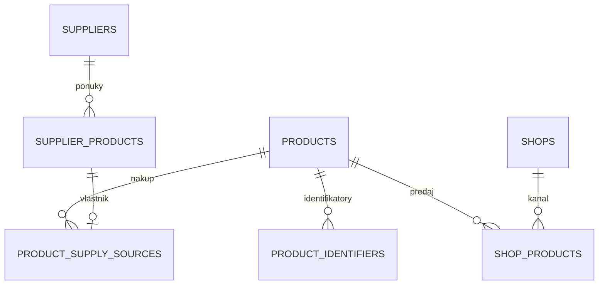
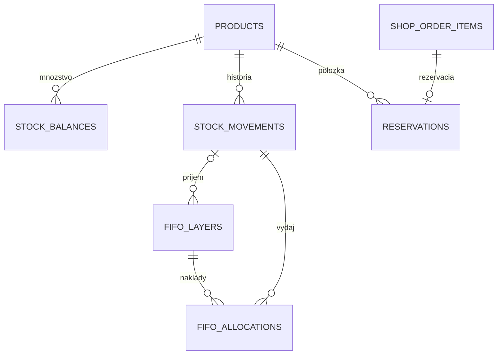

# Jednoduchý dátový model skladu

Rozhodnutie vlastníka z 22. 10. 2026: zachovať potrebné skladové funkcie, používať
interné databázové väzby a odstrániť konkurenčné zdroje rovnakého údaja.
Po kontrole možných kolízií vlastník výslovne ponechal automatické značkové
prefixy pri nových SKU, aby obsluha nemusela riešiť ich jedinečnosť. Tento dokument opisuje kontrakt implementácie v tomto PR;
úspešné nasadenie a stav konkrétnych živých údajov sa overujú samostatne.

## Identita a prepojenia

| Tabuľka / pole | Význam a pravidlo |
| --- | --- |
| `products.id` | Nemenné interné ID konkrétnej predajnej alebo servisnej položky. Referencia pre sklad, doklady a väzby. |
| `products.sku` | Jednoznačný kód pre obsluhu; existujúce kódy zostávajú. Nové SKU automaticky skladá Hub zo značkového prefixu a presného kódu konkrétneho výrobku/variantu. |
| `products.item_type` | `stock` alebo `service`. Služba môže mať kód aj e-shopovú väzbu, ale nevytvára fyzickú zásobu. |
| `products.stock_unit` | `pcs`, `pair`, `pack`, `m`. Pár/balenie je jedna kompletná predajná jednotka. |
| `product_identifiers` | `product_id`, typ, presná hodnota a pri dodávateľskom kóde aj `supplier_id`. Úvodné nuly a význam identifikátora zostávajú zachované. |
| `supplier_products.id` | Interné ID konkrétnej dodávateľskej ponuky. Kód ponuky je jednoznačný až spolu s dodávateľom. |
| `product_supply_sources` | Výslovná väzba `product_id` → `supplier_product_id`; jedna ponuka má jedného vlastníka. Produkt môže mať viac dodávateľov a najviac jeden primárny zdroj. |
| `shop_products` | Najviac jeden riadok pre dvojicu `shop_id`, `product_id`. Výslovná väzba nesie natívne ID a kód konkrétnej predajnej položky. |
| `shop_product_content` | Obnoviteľný obsah načítaný z e-shopu. Neurčuje vlastníctvo produktu ani fyzické množstvo. |

Čiarový kód, MPN, dodávateľský kód a SKU nie sú zameniteľné. Chýbajúce MPN
neblokuje obyčajnú kartu. Dva rozporné dôkazy identity sa nesmú vyriešiť
automatickým spojením kariet. Zhodný text kódu u dvoch dodávateľov sám osebe
neznamená rovnaký výrobok. Značkové prefixy rozlišujú rovnaké kódy rôznych
značiek; nenahrádzajú kontrolu identity a kolízie v cieľovom e-shope. Obsluha
nemusí vymýšľať suffixy ani nový číselný rad.

### Natívne ID v e-shope

| Druh položky | `external_product_id` | `external_variant_id` | `external_code` | `parent_code` |
| --- | --- | --- | --- | --- |
| Samostatný produkt | Natívne ID produktu | `NULL` | Predajný kód produktu | `NULL` |
| Variant | Natívne ID rodiča | Natívne ID variantu | Predajný kód variantu | Kód rodiča |

Číselne rovnaké ID produktu a variantu môžu existovať v odlišných natívnych
priestoroch. Jedno konkrétne natívne ID daného typu však nesmie v rovnakom
obchode vlastniť viac Hub kariet. Kód e-shopu sa môže líšiť od `products.sku`;
prenos používa overenú väzbu, nie domyslenú rovnosť kódov.

V BIKETREK sa nepodporuje súčasné zastúpenie jednej položky samostatným
produktom aj pokladňovým variantom. Konflikt sa vyrieši ponechaním samostatného
produktu a odstránením duplicitného variantu v e-shope. Migrácia samotná živé
produkty neodstraňuje. Neúplné alebo rozporné väzby vyžadujú overenie.

## Množstvá a nákupné ceny

Diagram zobrazuje vybrané cudzie kľúče. Príjemkový doklad je pri pohybe
evidovaný cez `reference_type`, `reference_id` a `reference_source`; nejde
o priamy cudzí kľúč na `receiving_lines`. Vrstvy pri staršom FIFO prechode
môžu mať `cutover_id` namiesto `receipt_movement_id`.

| Údaj | Autoritatívny zdroj |
| --- | --- |
| Potvrdenie, že evidujeme vlastný sklad | `stock_tracking` pre produkt/sklad |
| Aktuálne vlastné množstvo | `stock_balances`, odvodené a menené skladovými operáciami |
| História príjmov, výdajov, opráv | Nemenné `stock_movements` |
| Rezervácie | `reservations` a príslušná objednávková položka |
| Obstarávací náklad | FIFO vrstvy a pôvodné alokácie výdaja; neznáma cena zostáva `NULL` |
| Dodávateľská ponuka | `supplier_products`, cez `product_supply_sources` |
| Čerstvá dodávateľská dostupnosť | `supplier_availability_observations` s časom platnosti |
| Pôvod vytvorenia karty | `created_from_source`, `source_supplier_product_id`; informácia o pôvode, nie náhradná aktívna väzba |

Nákupný prepočet sa zadáva pri príjemke cez `purchase_unit` a
`purchase_to_stock_factor`. Napríklad 2 balenia po 10 kusov za 30 EUR/balenie
vytvoria príjem 20 kusov s nákladom 3 EUR/kus. Pôvodné faktúrové množstvo a cena
zostanú na príjemke. Staré `pack_size` samo nespúšťa prepočet. Opakovanie tej
istej finalizácie nevytvorí druhý príjem.

Typ a základná jednotka karty sa po vzniku fyzickej histórie alebo rezervácií
nedajú meniť tak, aby sa spätne preinterpretovali množstvá. Služba sa identifikuje
ako konkrétna karta a v objednávke/príjme sa spracuje bez fyzických pohybov.
Chybný alebo nenájdený kód fyzického tovaru sa nesmie preznačiť na službu.

Metre umožňujú desatinné množstvá v podporovaných lokálnych skladových
operáciách. E-shopové objednávkové a publikačné cesty, ktoré vyžadujú celé
predajné jednotky, musia nepodporovanú jednotku výslovne odmietnuť; nikdy ju
nezaokrúhľujú na kusy. Nasadenie automaticky nerozširuje schopnosti konektora.

## Migrácia a údržba

- `030_shop_identity.sql`: normalizované ID, jednoznačné natívne vlastníctvo,
  jednorazový prenos iba overiteľných pôvodných údajov.
- `031_item_units.sql`: typ karty, základná jednotka, výslovný nákupný faktor
  a ochrana pred fyzickými pohybmi služby či zmenou jednotky s históriou.
- `032_supplier_authority.sql`: jednoznačné dodávateľské vlastníctvo a
  jednorazové doplnenie preukázateľných relačných väzieb.

Pôvodné stĺpce sa deštruktívne nemažú a staré pohyby sa neprepočítavajú.
Aktívny kód používa jednotný nový kontrakt. Uložené výsledky operácií,
prerušených odoslaní, doklady a FIFO alokácie zostávajú potrebnou evidenciou;
nie sú náhradným zdrojom aktuálnej produktovej identity.

Zmena neaktivuje skladovú autoritu, automatické objednávkové spracovanie ani
zápisy do e-shopov. Po zápisoch v novom modeli sa prípadná chyba opravuje
kompatibilným ďalším nasadením; návrat k starým zapisovačom, ktoré ignorujú
jednotky alebo nové ID, nie je bezpečná obnova.

Súvisiace kontrakty: [SKU](sku-policy.md), [e-shopové väzby](product-links.md),
[dodávateľské väzby](supplier-card-links.md), [príjem](receiving-identity.md),
[FIFO](fifo.md), [editor](product-editor.md) a [spustenie skladu](stock-start-plan.md).
